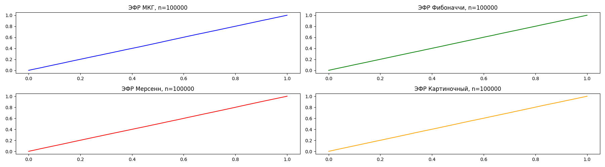
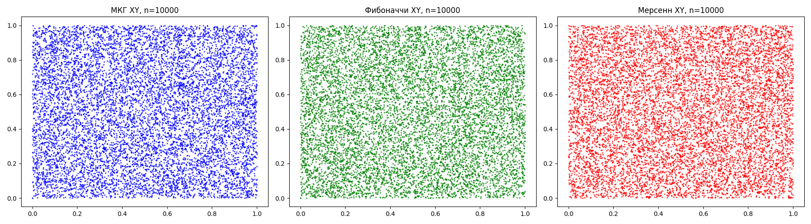
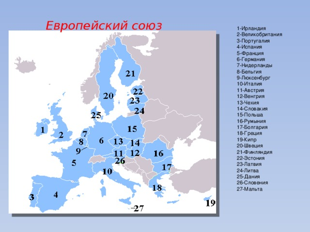

# Лабораторная работа №2. Генераторы случайных чисел

Сравнение четырёх способов получения псевдослучайных чисел на интервале `[0, 1)`:

- мультипликативного конгруэнтного генератора Парка — Миллера;
- вычитающего генератора Фибоначчи с лагами 63 и 31;
- MT19937 из стандартного модуля `random`;
- генератора, использующего младшие биты пикселей изображения как источник начальной энтропии и SHA-256 для получения последовательности.

Для выборок объёмом 1 000, 5 000, 10 000 и 100 000 программа вычисляет среднее, дисперсию и стандартное отклонение, а затем строит гистограммы, эмпирические функции распределения и диаграммы пар соседних значений.

## Результаты

### Гистограммы


### Эмпирические функции распределения



### Диаграммы соседних значений



## Входные изображения

В текущей конфигурации источником энтропии служит `example_2.jpg`.

| `example_1.jpg` | `example_2.jpg` |
|---|---|
|  |  |

## Запуск

```powershell
cd 4ModLab2
pip install numpy matplotlib pillow
python main.py
```

Каталог `graphics` должен существовать до запуска. Размеры выборок задаются списком `sample_sizes`, а используемое изображение — аргументом функции `image_random` в `main.py`.

## Файлы

- `main.py` — генераторы, расчёт статистик и построение графиков;
- `example_1.jpg`, `example_2.jpg` — изображения для эксперимента;
- `graphics/` — сохранённые графики для всех объёмов выборки.
