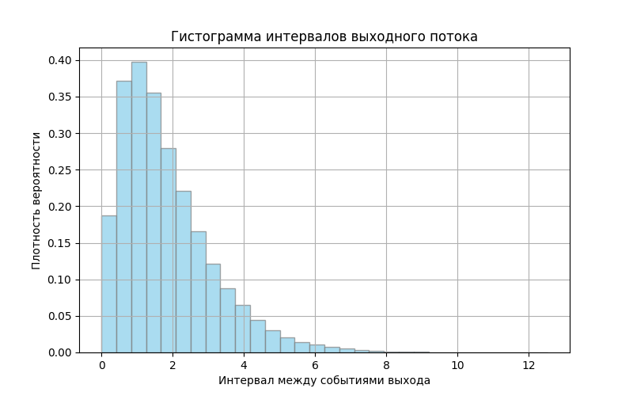
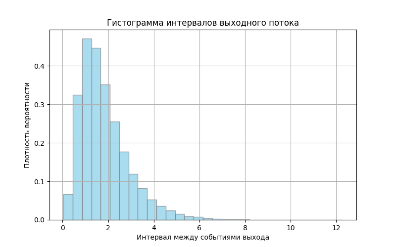
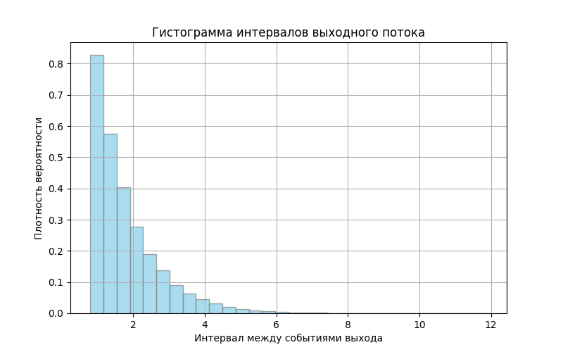
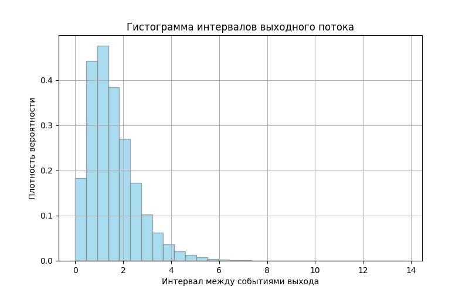
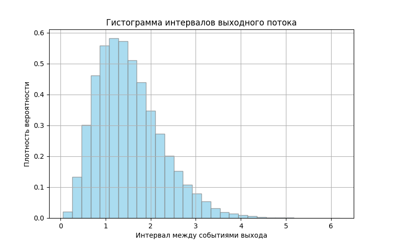
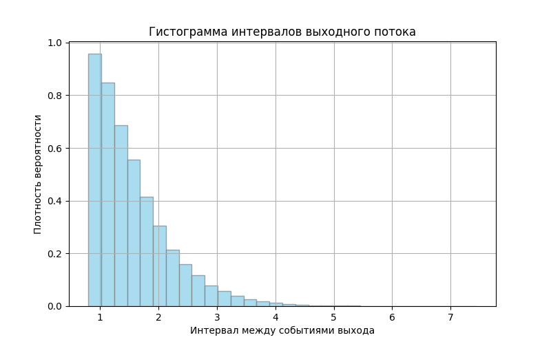

# Лабораторная работа №5. Одноканальная СМО без очереди

Дискретно-событийная модель одноканальной системы массового обслуживания с потерями. Если новая заявка приходит во время обслуживания, она покидает систему.

## Модель

Входной поток может быть пуассоновским или эрланговским. Время обслуживания задаётся одним из четырёх распределений:

- экспоненциальным;
- эрланговским;
- равномерным;
- постоянным.

Модель последовательно выбирает ближайшее событие — приход или завершение обслуживания — и переводит часы сразу к его моменту. По итогам вычисляются число заявок, число обслуженных и потерянных заявок, вероятность блокировки, пропускная способность, коэффициент загрузки, среднее и дисперсия интервалов выходного потока.

## Примеры результатов

| Экспоненциальное обслуживание | Эрланговское обслуживание | Постоянное обслуживание |
|---|---|---|
|  |  |  |
|  |  |  |

## Запуск

```powershell
cd 4ModLab5
pip install -r requirements.txt
python main.py
```

Параметры эксперимента находятся в начале `main.py`: `arrival_dist`, `lambda_arrival`, `k_arrival`, `service_dist`, параметры обслуживания и длительность `T_end`. Для воспроизведения нужного сочетания измените эти значения перед запуском.

## Файлы

- `main.py` — событийная модель и расчёт характеристик;
- `requirements.txt` — зависимости;
- `results/` — графики для шести сочетаний входного потока и обслуживания.
