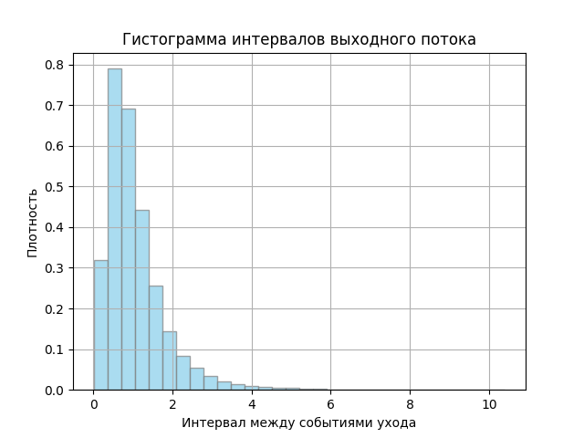
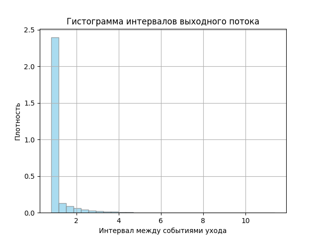
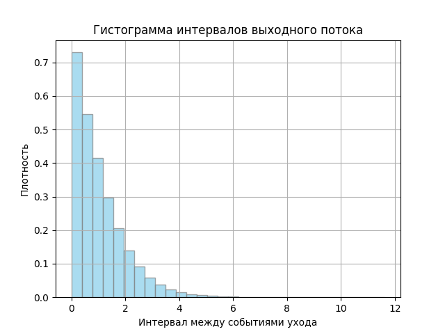
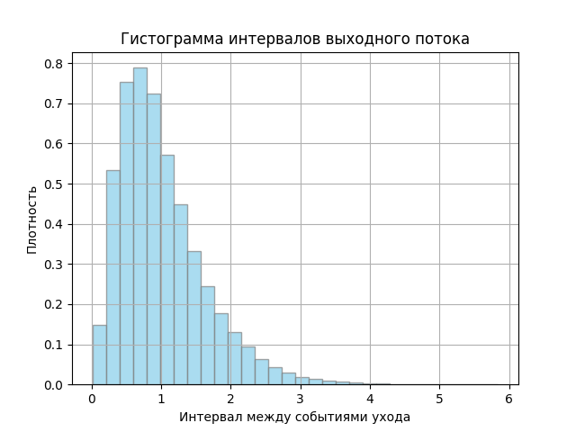
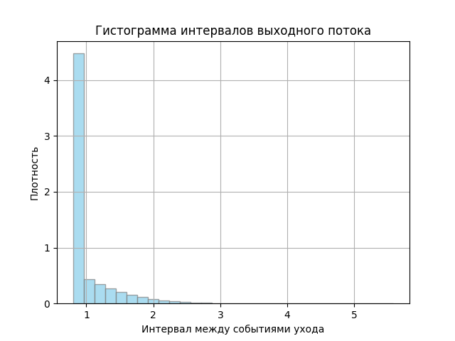

# Лабораторная работа №6. Одноканальная СМО с конечной очередью

Дискретно-событийная модель одноканальной системы массового обслуживания с ограниченной очередью. Свободный канал сразу принимает заявку, занятый направляет её в очередь, а при заполненной очереди заявка теряется.

## Модель

Поддерживаются пуассоновский и эрланговский входные потоки, а также экспоненциальное, эрланговское, равномерное и постоянное время обслуживания. Очередь работает по дисциплине FIFO.

После моделирования программа выводит:

- общее число заявок;
- число принятых на обслуживание и потерянных заявок;
- вероятность потери;
- пропускную способность;
- коэффициент загрузки канала;
- среднее и дисперсию интервалов выходного потока.

## Примеры результатов

| Экспоненциальное обслуживание | Эрланговское обслуживание | Постоянное обслуживание |
|---|---|---|
|  |  |  |
|  |  |  |

## Запуск

```powershell
cd 4ModLab6
pip install -r requirements.txt
python main.py
```

Основные параметры находятся в начале `main.py`. Размер очереди задаёт `queue_limit` (по умолчанию 5), длительность моделирования — `T_end`, законы входного потока и обслуживания — `arrival_dist` и `service_dist`.

## Файлы

- `main.py` — событийная модель с FIFO-очередью;
- `requirements.txt` — зависимости;
- `results/` — графики для шести сочетаний входного потока и обслуживания.
