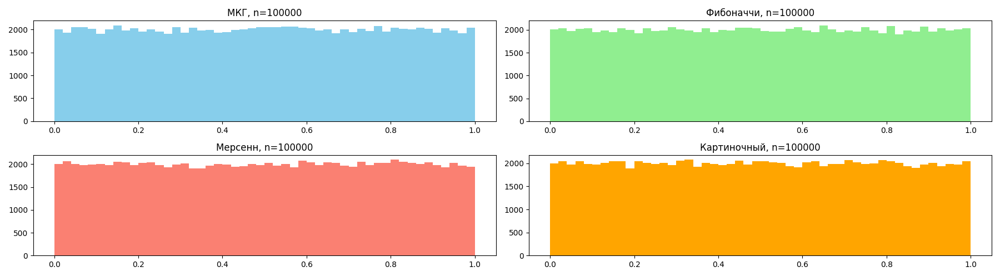
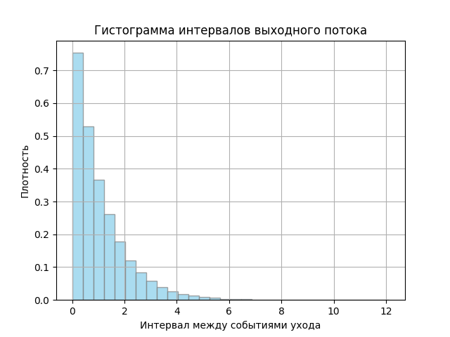

# Имитационное моделирование

Учебный репозиторий с шестью лабораторными работами по имитационному и статистическому моделированию. Здесь реализованы клеточный автомат, генераторы псевдослучайных чисел, метод Монте-Карло, модели потоков событий и одноканальные системы массового обслуживания.

## Лабораторные работы

| Работа | Тема | Результат |
|---|---|---|
| [Лабораторная №1](4ModLab1/README.md) | Клеточный автомат «Игра Жизнь» | Анимации эволюции поля для правил B3/S23, B36/S23 и B3678/S34678 |
| [Лабораторная №2](4ModLab2/README.md) | Генераторы случайных чисел | Сравнение МКГ, генератора Фибоначчи, MT19937 и генератора на основе изображения |
| [Лабораторная №3](4ModLab3/README.md) | Метод Монте-Карло | Экспериментальная оценка числа π и требуемого числа испытаний |
| [Лабораторная №4](4ModLab4/README.md) | Потоки событий | Пуассоновский и эрланговский потоки, сравнение собственных алгоритмов с NumPy |
| [Лабораторная №5](4ModLab5/README.md) | СМО без очереди | Одноканальная система с потерями и разными законами распределения |
| [Лабораторная №6](4ModLab6/README.md) | СМО с очередью | Одноканальная система с конечной очередью и потерями при переполнении |

## Примеры результатов

### Клеточный автомат


### Генераторы случайных чисел



### Потоки событий


### Система массового обслуживания с конечной очередью



## Технологии

- Python 3.10+
- NumPy — вычисления и генерация случайных величин;
- Matplotlib — графики и анимации;
- Pillow — чтение изображений и сохранение GIF;
- SciPy и pandas указаны в зависимостях отдельных работ.

## Запуск

Клонируйте репозиторий и создайте виртуальное окружение:

```powershell
git clone https://github.com/Diminasss/Simulation-modeling.git
cd Simulation-modeling
python -m venv .venv
.\.venv\Scripts\Activate.ps1
pip install numpy matplotlib pillow scipy pandas
```

Каждая работа запускается отдельно из своей папки. Например:

```powershell
cd 4ModLab4
python main.py
```

Запуск из папки лабораторной важен: программы сохраняют изображения и читают входные файлы по относительным путям. Подробные параметры и команды приведены в README каждой работы.

## Структура репозитория

```text
.
├── 4ModLab1/   # клеточный автомат
├── 4ModLab2/   # генераторы случайных чисел
├── 4ModLab3/   # метод Монте-Карло
├── 4ModLab4/   # пуассоновский и эрланговский потоки
├── 4ModLab5/   # СМО без очереди
└── 4ModLab6/   # СМО с конечной очередью
```

## Что исследуется

Работы показывают, как строить стохастические модели, собирать статистику экспериментов и визуально проверять полученные распределения. В моделях СМО рассчитываются число обслуженных и потерянных заявок, вероятность блокировки, пропускная способность, загрузка канала и характеристики выходного потока.
